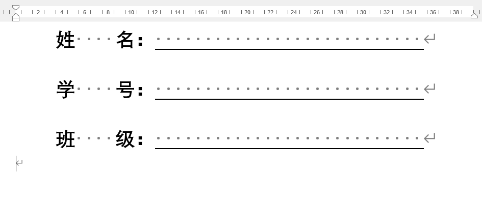
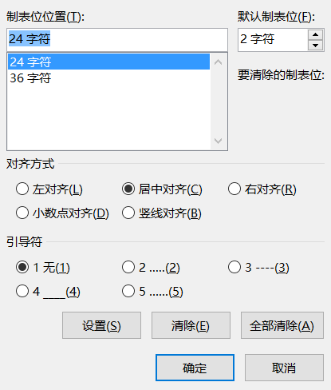
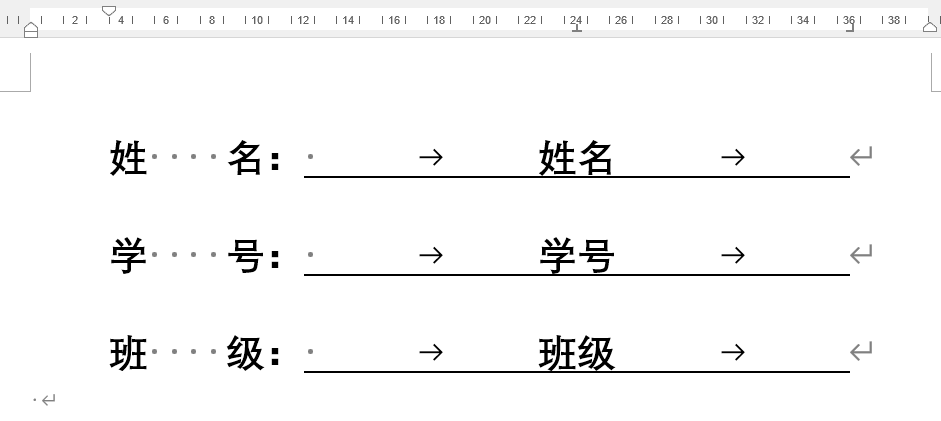

1. 打开word标尺功能
	- 工具栏--视图--显示--标尺
	- 用alt+w+r
	
2. 根据模板定位横线的中间位置和末尾的位置
	比如下图的中间和末尾大概在24和36的位置
	
3. 把横线部分删去,要是不想在添加下划线,可保留一字符的空,并填写好信息,选中文字部分
	 
4. 打开段落设置,选择左下角的制表位,填些中间位置和末尾的信息,中间的选择为居中对齐,末尾选择为右对齐,设置完点击确定
	
5.  光标放在文字开头,按下键盘的tab键,文字就居中了,
	光标移动到文字末尾,同样按下tab键,末尾就完成了对齐
	